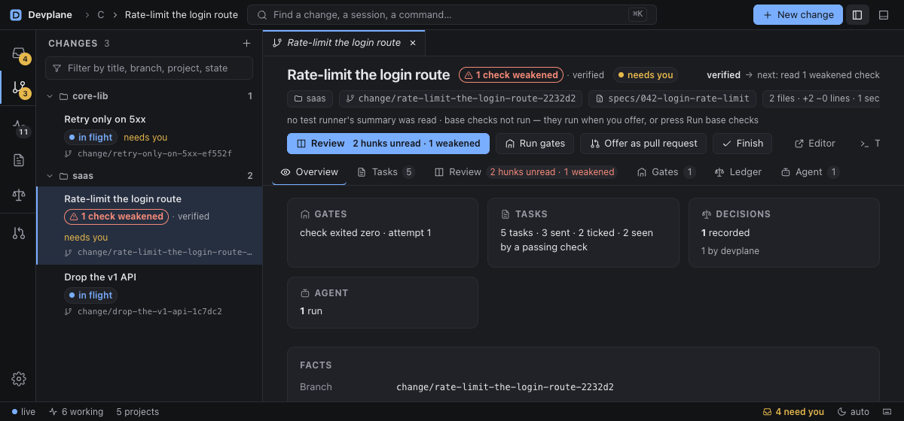

# Devplane

Devplane puts in front of you, in minutes, the evidence for deciding whether an agent's change is
safe to merge — evidence your own project produces — and keeps the record of how you know.

**[Documentation → hupe1980.github.io/devplane](https://hupe1980.github.io/devplane)**



## Install

```sh
# macOS (Apple Silicon) and Linux
curl -LsSf https://github.com/hupe1980/devplane/releases/latest/download/devplane-installer.sh | sh

# the same binaries through npm, plus Windows x86_64
npm install -g devplane

# anything else, from source (Rust 1.94+); add --features app for the desktop window
cargo install --locked devplane
```

The macOS binaries are not notarised: use the installer, not a browser download. The desktop app's
packages are on the [releases page](https://github.com/hupe1980/devplane/releases); a package built
without signing credentials says `-unsigned` in its name, and your system warns before opening it.
[Install guide →](https://hupe1980.github.io/devplane/docs/install/)

## Quickstart

In a repository whose `devplane.toml` says what done means:

```toml
[gates]
check = ["cargo clippy -- -D warnings", "cargo test"]
```

```sh
devplane up                                       # the host and workbench; the rest in a 2nd terminal
devplane project trust .                          # lists the repo's hooks and MCP servers, then asks
devplane change start "fix the flaky login test"  # a worktree, an agent, your check when it stops
devplane change review <id>                       # weakened checks first, then every file
devplane change offer <id>                        # commits exactly the tree that passed
```

Starting an agent needs it signed in, and Node for the built-in agents that run through `npx`.
`devplane --help` sorts the eighteen commands into five groups.
[Quickstart →](https://hupe1980.github.io/devplane/docs/quickstart/)

## Documentation

[Quickstart](https://hupe1980.github.io/devplane/docs/quickstart/) ·
[Verified done](https://hupe1980.github.io/devplane/docs/verified-done/) ·
[Workbench](https://hupe1980.github.io/devplane/docs/workbench/) ·
[CLI](https://hupe1980.github.io/devplane/docs/cli/) ·
[Configuration](https://hupe1980.github.io/devplane/docs/configuration/) ·
[Agents](https://hupe1980.github.io/devplane/docs/agents/) ·
[Permissions](https://hupe1980.github.io/devplane/docs/permissions/) ·
[CI](https://hupe1980.github.io/devplane/docs/ci/) ·
[Security](https://hupe1980.github.io/devplane/docs/security/)

## Development

See [CONTRIBUTING.md](CONTRIBUTING.md). Changes are listed in [CHANGELOG.md](CHANGELOG.md).

## License

MIT or Apache-2.0, at your option.
