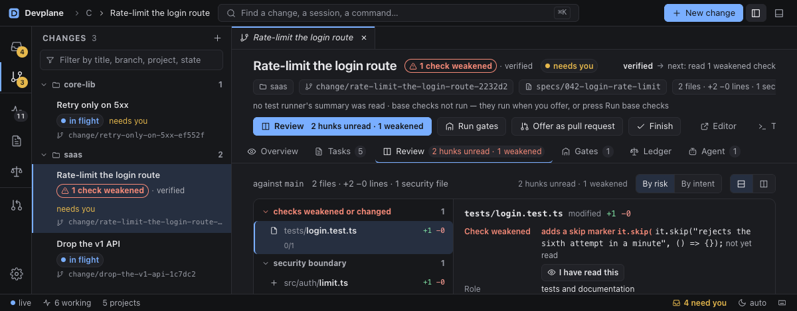

# Devplane

**Know when an agent's work is actually done.** Run any
[Agent Client Protocol](https://agentclientprotocol.com) agent in its own worktree, verify its change
with your own checks run outside the agent, see weakened tests first, and keep a record of who
decided what. One local binary: no account, no cloud relay, loopback only. Delete it and the project
still builds.

**[Documentation → hupe1980.github.io/devplane](https://hupe1980.github.io/devplane)**




## Install

```sh
# prebuilt binary: macOS (Apple Silicon) and Linux
curl -LsSf https://github.com/hupe1980/devplane/releases/latest/download/devplane-installer.sh | sh

# prebuilt binary through npm: the same, plus Windows x86_64
npm install -g devplane

# anything else, from source (Rust 1.94+); add --features app for the desktop window
cargo install --locked devplane
```

On macOS use the installer, not a browser download (binaries are not notarised). Intel Macs build
from source. [Install guide →](https://hupe1980.github.io/devplane/docs/install/)

## Sixty seconds

```sh
devplane status                # sessions already running on this machine — no setup
devplane agent connect claude  # hooks + telemetry into your user settings; shows the diff, asks
devplane up                    # the workbench in your browser; this terminal becomes the host
```

In a repository, in a second terminal:

```toml
# devplane.toml — committed, so the definition of done is reviewed like code
[gates]
check = ["cargo clippy -- -D warnings", "cargo test"]
```

```sh
devplane project trust .                          # lists the repo's hooks and MCP servers, then asks
devplane change start "fix the flaky login test"  # a worktree, an agent, and your gate when it stops
devplane change show <id>                         # verified, stale, or what failed
```

Starting an agent needs Node (built-in agents run through `npx`) and the agent signed in. GitHub is
optional (`devplane auth login`). [Quickstart →](https://hupe1980.github.io/devplane/docs/quickstart/)

## The loop

- **Specify** — name a spec folder and tasks; Devplane reads Markdown and `- [ ]` boxes, no spec format.
- **Start** — a worktree on its own branch, your setup command, then the agent; one prompt can span repositories.
- **Supervise** — the inbox ranks what needs a person across every project.
- **Verify** — your `check` runs when the agent stops. **Verified** means it passed against the tree that is there now; touch a file and it is stale.
- **Review and offer** — weakened checks come first; offering is refused until a person has read them, then commits exactly the tree that passed and opens a draft PR or prints the push command.
- **CI** — `devplane verify` runs the base branch's `check` on a pull request. [CI →](https://hupe1980.github.io/devplane/docs/ci/)

Devplane never approves a tool call: it refuses one or asks you. `devplane --help` sorts the
eighteen commands into five groups.

## Documentation

[Quickstart](https://hupe1980.github.io/devplane/docs/quickstart/) ·
[Workbench](https://hupe1980.github.io/devplane/docs/workbench/) ·
[CLI](https://hupe1980.github.io/devplane/docs/cli/) ·
[Configuration](https://hupe1980.github.io/devplane/docs/configuration/) ·
[Agents](https://hupe1980.github.io/devplane/docs/agents/) ·
[Permissions](https://hupe1980.github.io/devplane/docs/permissions/) ·
[Architecture](https://hupe1980.github.io/devplane/docs/architecture/) ·
[Security](https://hupe1980.github.io/devplane/docs/security/)

## Development

Everything is a [`just`](https://just.systems) recipe; `just verify` is the gate. See
[CONTRIBUTING.md](CONTRIBUTING.md) and [CHANGELOG.md](CHANGELOG.md).

## License

MIT or Apache-2.0, at your option.
